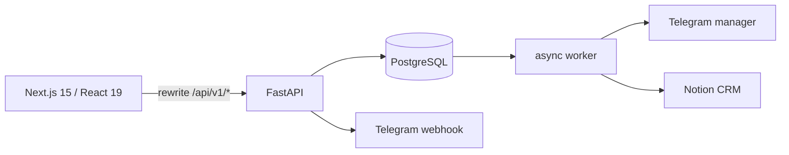

# Міграція VIKORA на Cloudflare

## Поточна архітектура

- Next.js App Router переважно рендерить статичні сторінки. Калькулятор і форма є client components.
- Каталог, контакти й технології зараз імпортуються з JSON FastAPI під час збірки frontend.
- FastAPI використовує strict Pydantic, параметризований SQLAlchemy, PostgreSQL advisory lock для idempotency, транзакційні `delivery_jobs`, Telegram webhook та окремий worker.
- Email/SMTP інтеграції немає. Notion і Telegram є опційними server-side інтеграціями.
- Python backend залишається в `backend/` до окремого погодження видалення.

## API compatibility matrix

| Поточний FastAPI | Cloudflare Worker | Статус міграції |
|---|---|---|
| `GET /api/v1/products` | статичний каталог frontend з `backend/app/config/products.json` | Наразі фронтенд уже читає той самий JSON напряму; окремий endpoint Worker не створюється |
| `GET /api/v1/products/{product_id}` | статична сторінка `assortment/[id]` | SSR/SSG з наявного JSON каталогу |
| `GET /api/v1/products/{product_id}/options` | статичні поля продукту у frontend JSON | Не потребує окремого запиту у поточному UI |
| `GET /api/v1/contact-information` | `GET /api/contacts` | Новий стабільний контракт, кеш 60 с |
| `GET /api/v1/technologies` | статична сторінка технологій з `backend/app/config/technologies.json` | Залишено як локальні контентні дані frontend |
| `GET /api/v1/calculator/options` | статичні назви продуктів та опцій у frontend | Тестові ціни завантажуються окремо з `/api/prices` |
| `POST /api/v1/calculator/estimate` | `GET /api/prices` + розрахунок frontend | Формула дублюється у спільних контрактних тестах; backend повторно перевіряє ціну при заявці |
| `POST /api/v1/quote-requests` | `POST /api/leads` | Сумісні поля + обов'язковий Turnstile token у production |
| `POST /api/v1/telegram/webhook` | `POST /internal/telegram/webhook` | Приватний server-only endpoint із secret header та replay protection |
| products / technologies | статичні Next.js дані | Публічний Worker API не потрібний |
| `GET /health` | `GET /health` | D1 readiness |

Frontend перемикається через `API_URL` на сервері та `NEXT_PUBLIC_API_BASE_URL` у браузері. Production URL не зашитий у код.

## Дані й міграція

1. Створити окремі D1 для staging і production.
2. Застосувати `cloudflare-backend/migrations` спочатку до staging.
3. Імпортувати актуальні pricing rules, contacts і Telegram admin IDs контрольованим SQL/скриптом.
4. PostgreSQL leads експортувати без `rate_buckets`, `bot_sessions` і технічних lock-даних; PII переносити лише за підтвердженою потребою та політикою зберігання.
5. Звірити кількість заявок, public IDs, idempotency keys, статуси та Notion page IDs.
6. На час cutover зупинити приймання записів старим API, виконати фінальний delta import, перемкнути frontend і перевірити synthetic lead.
7. PostgreSQL і FastAPI залишити read-only до завершення періоду спостереження.

D1 зберігає ціни як цілі `value_micros`, бо SQLite `REAL` не гарантує decimal-точність. Заявка й два outbox events записуються одним `D1.batch()`. Унікальний `idempotency_key` захищає від повтору.

## Основні ризики

- D1 не має PostgreSQL advisory locks або `SELECT FOR UPDATE`; конкурентність покладається на unique constraints, conditional updates і короткі leases.
- Реальну схему Notion неможливо підтвердити без доступу до data source. Мапінг лишається конфігураційним і має пройти staging перевірку.
- Turnstile потребує site key у frontend і secret у Worker. Bypass дозволений лише локально.
- Queue delivery має at-least-once semantics, тому Telegram/Notion consumers перевіряють persistent delivery status.
- Неоднозначний Notion create можна вручну відновити через CRM retry: consumer лише шукає Lead ID і не створює повторну сторінку. Неоднозначний Telegram `sendMessage` залишається в ручній перевірці, бо Telegram не має ключа ідемпотентності для відправки.
- Нові outbox events потрапляють у Queue з планового recovery максимум за п’ять хвилин; downstream retry та дедуплікація залишаються незалежними для кожної системи.
- Динамічні контакти мають короткий кеш; зміна стає видимою максимум приблизно за 60 секунд.
- Політика приватності ще потребує реквізитів оператора, строків зберігання та процедури видалення до приймання реальних даних.
- Адаптер OpenNext попереджає про обмежену сумісність на Windows; його production build має пройти в Linux CI або WSL перед staging.

## Security checklist

- [x] Публічна заявка валідовується строгими Zod-схемами; сервер перераховує суму з актуальними правилами.
- [x] D1 запити параметризовані; lead, delivery status та outbox записуються атомарним batch.
- [x] Приймається лише JSON до 32 KiB із тайм-аутом читання; multipart і стиснені тіла відхиляються.
- [x] Edge rate limits для публічного API та додатковий D1 ліміт для заявок.
- [x] Turnstile перевіряється server-side за action і hostname; bypass доступний лише local/test.
- [x] CORS має allowlist; приватні lead/admin endpoints не експонуються у frontend.
- [x] Telegram webhook вимагає secret header, admin allowlist та persistent update lease/deduplication.
- [x] PII endpoints мають `no-store`; помилки й delivery codes не повертають upstream тіла.
- [x] File uploads не підтримуються; браузерна форма відхиляє `File` значення.
- [ ] До staging замінити домени й D1 IDs, додати production secrets, налаштувати справжній Turnstile і звірити CORS origins.
- [ ] До приймання клієнтських даних завершити privacy policy, строки зберігання й видалення.

## Checklist

- [x] Аудит FastAPI, Pydantic, моделей, міграцій, форми, frontend rewrites, Telegram, Notion і CI.
- [x] Ізольований TypeScript/Hono Worker без видалення Python.
- [x] D1 schema, seed, indexes, idempotency та transactional outbox.
- [x] Queue consumer, retry, dead-letter status і Cron recovery.
- [x] grammY webhook, admin allowlist, replay protection, audit і підтвердження змін.
- [x] Notion client, deduplication, page ID persistence і retry classification.
- [x] Zod, CORS, Turnstile, size/rate limits, security headers і safe errors.
- [x] Frontend integration, duplicate-submit protection та dynamic prices/contacts.
- [x] CI checks і ручні staging/production workflows з GitHub Environments.
- [ ] Створити Cloudflare resources і додати реальні binding IDs (потребує авторизації).
- [ ] Перевірити staging Telegram/Notion credentials та існуючу Notion schema.
- [ ] Виконати PostgreSQL export/import і production cutover (потребує окремого погодження).
